<div align="center">

# 🔐 Secure File Transfer System with End-to-End Encryption
## نظام نقل الملفات الآمن مع التشفير من طرف إلى طرف

**مشروع تخرج** — نقل ملفات مشفّر بين جهازين (Windows) على نفس الشبكة المحلية،
مع اكتشاف تلقائي للأجهزة، ولوحة تحكم رسومية، وتحقق من الهوية والسلامة.

`X25519` · `Ed25519` · `HKDF-SHA256` · `AES-256-GCM` · `SHA-256` · `Python 3`

</div>

---

## 📑 المحتويات
0. [🎓 عرض المشرف (Presentation)](#-عرض-المشرف-presentation)
1. [فكرة المشروع](#-فكرة-المشروع)
2. [المميزات](#-المميزات)
3. [صور النظام](#-صور-النظام)
4. [التنصيب والتشغيل على جهازي Windows (خطوة بخطوة)](#-التنصيب-والتشغيل-على-جهازي-windows)
5. [طريقة الاستخدام](#-طريقة-الاستخدام)
6. [المخطط المعماري](#-المخطط-المعماري-architecture)
7. [طريقة التشفير المتبعة (ملخّص)](#-طريقة-التشفير-المتبعة)
8. [المخططات الانسيابية (Flowcharts)](#-المخططات-الانسيابية-flowcharts)
9. [إثبات الأمان عملياً (تنصّت + تلاعب)](#-إثبات-الأمان-عملياً)
10. [هيكل المشروع](#-هيكل-المشروع)
11. [الاختبارات](#-الاختبارات)
12. [حل المشاكل](#-حل-المشاكل-الشائعة)
13. [المصادر والمراجع](#-المصادر-والمراجع)

📘 التوثيق التفصيلي:
[شرح التشفير بالتفصيل](docs/ENCRYPTION.md) ·
[البروتوكول وصيغة الرسائل](docs/PROTOCOL.md) ·
[دليل التنصيب على Windows](docs/INSTALL_WINDOWS.md) ·
[تحليل الأمان والتهديدات](docs/SECURITY_ANALYSIS.md) ·
[المصادر](docs/REFERENCES.md)

---

## 🎓 عرض المشرف (Presentation)

<a href="docs/presentation/Supervisor_Presentation.pdf">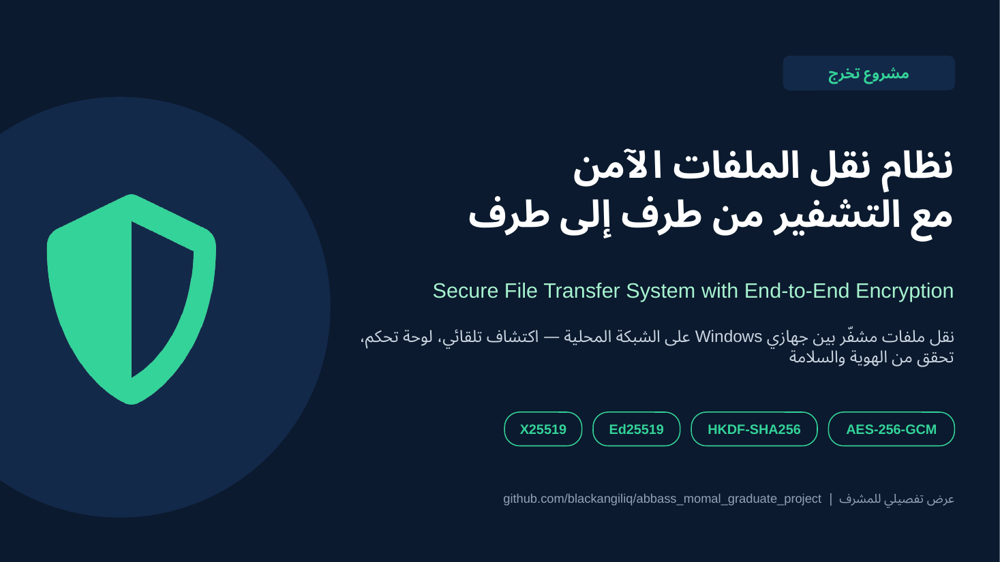</a>

عرض تقديمي كامل من **33 شريحة** يشرح كل تفاصيل المشروع للمشرف ولجنة المناقشة. يحتوي على ملاحظات للمتحدث (Speaker Notes) في كل شريحة.

| الملف | الاستخدام |
|---|---|
| 📄 **[Supervisor_Presentation.pdf](docs/presentation/Supervisor_Presentation.pdf)** | يُعرض مباشرة في GitHub أو أي متصفح |
| 📊 **[Supervisor_Presentation.pptx](docs/presentation/Supervisor_Presentation.pptx)** | للعرض والتعديل في PowerPoint (يحتوي ملاحظات المتحدث) |

<details><summary><b>محتوى الشرائح (اضغط للعرض)</b></summary>

| # | الشريحة | # | الشريحة |
|---|---|---|---|
| 1 | الغلاف | 18 | بروتوكول التطبيق والتحقق من سلامة الملف |
| 2 | محاور العرض | 19 | ▸ قسم: سير العمل والاكتشاف |
| 3 | المشكلة: التنصت، التلاعب، انتحال الهوية | 20 | المخطط الانسيابي للمرسل |
| 4 | أهداف المشروع + الأرقام الأساسية | 21 | المخطط الانسيابي للمستلم |
| 5 | مقارنة مع SMB / FTP / HTTP / SFTP | 22 | اكتشاف الأجهزة: 3 طرق |
| 6 | ▸ قسم: المعمارية والتصميم | 23 | ▸ قسم: التطبيق والاختبارات |
| 7 | المخطط المعماري للجهازين | 24 | لوحة التحكم |
| 8 | المكوّنات البرمجية والتقنيات | 25 | طلب الاستلام ونفس رمز التحقق على الشاشتين |
| 9 | المنافذ والبيانات المخزّنة + حماية لوحة التحكم | 26 | اكتمال النقل والتحقق من SHA-256 |
| 10 | ▸ قسم: التشفير بالتفصيل | 27 | إثبات الأمان: تجربة تنصّت وتلاعب حقيقية |
| 11 | الخوارزميات ولماذا اخترناها | 28 | الاختبارات الآلية (8/8) |
| 12 | المفاتيح في النظام والبصمة | 29 | تحليل التهديدات STRIDE |
| 13 | المصافحة خطوة بخطوة (9 رسائل) | 30 | ▸ قسم: التنصيب والخلاصة |
| 14 | رياضيات المصافحة (ECDH، التوقيع، ربط الرسائل) | 31 | التنصيب والتشغيل على Windows |
| 15 | اشتقاق المفاتيح بـ HKDF-SHA256 | 32 | حدود التصميم والتطوير المستقبلي |
| 16 | تشفير كل قطعة: الإطار، الـ Nonce، الـ AAD | 33 | الخلاصة |
| 17 | رمز التحقق SAS والثقة TOFU | | |

</details>

---

## 💡 فكرة المشروع
عند نقل الملفات عبر الشبكة بالطرق العادية (مجلد مشترك SMB، FTP، HTTP) يمكن لأي شخص على نفس الشبكة
أن **يتنصت** على المحتوى أو **يعدّله** أو **ينتحل شخصية** الجهاز الآخر (Man-in-the-Middle).

هذا النظام يحل المشكلة: يُشغَّل البرنامج على الجهازين، فيكتشف كل جهاز الآخر تلقائياً
(أو يُدخَل عنوان IP يدوياً)، ثم:

1. يتفق الجهازان على **مفتاح جلسة سري جديد** باستخدام **X25519 (ECDH)**، ولا ينتقل هذا المفتاح عبر الشبكة.
2. يثبت كل جهاز **هويته** بتوقيع رقمي **Ed25519**.
3. يُشفَّر الملف قطعةً قطعة بـ **AES-256-GCM** الذي يضمن **السرية + السلامة + الأصالة** معاً.
4. يتحقق المستلم في النهاية من بصمة **SHA-256** للملف كاملاً.
5. يقارن المستخدمان **رمز تحقق من 6 أرقام (SAS)** يظهر على الشاشتين لكشف أي هجوم وسيط.

> **التشفير من طرف إلى طرف (E2EE):** الملف يُشفَّر على جهاز المرسل ولا يُفك إلا على جهاز المستلم.
> أي جهاز وسيط (راوتر، سويتش، مهاجم على الـ Wi-Fi) يرى بيانات عشوائية فقط.

## ✨ المميزات
| الميزة | التفاصيل |
|---|---|
| 🔒 تشفير قوي | AES-256-GCM مع مفاتيح جلسة مشتقة بـ HKDF-SHA256 |
| 🔑 سرية أمامية (PFS) | مفاتيح X25519 مؤقتة لكل اتصال؛ سرقة الجهاز لاحقاً لا تكشف الجلسات السابقة |
| 🪪 مصادقة الهوية | توقيع Ed25519 + بصمة لكل جهاز + آلية الثقة عند أول استخدام (TOFU) كما في SSH |
| 🔢 رمز التحقق SAS | 6 أرقام تظهر عند الطرفين — يجب أن تتطابق |
| 🛡️ كشف التلاعب والإعادة | أي بت يتغير أو أي رسالة تُعاد/يتغير ترتيبها تُكتشف فوراً ويُقطع الاتصال |
| ✅ سلامة الملف | SHA-256 للملف كاملاً قبل الإرسال وبعد الاستلام |
| 📡 اكتشاف تلقائي | بث UDP + **مسح الشبكة المحلية** (TCP scan) + إدخال IP يدوي |
| 🖥️ لوحة تحكم | واجهة ويب عربية: سحب وإفلات، شريط تقدم، السرعة، سجل العمليات |
| ✔️ موافقة المستلم | لا يُستلم أي ملف بدون موافقة (أو قبول تلقائي من الأجهزة الموثوقة فقط) |
| ⚡ تشغيل بنقرة | `START.bat` يثبت كل شيء ويفتح الجدار الناري ويشغّل النظام ويعرض الـ IP |
| 🧱 حماية إضافية | تنظيف أسماء الملفات (Path Traversal)، حد لحجم الإطار، لوحة التحكم على 127.0.0.1 فقط مع Token |

---

## 📸 صور النظام

> الصور التُقطت من نسختين للبرنامج على حاسوب اختبار واحد (لذلك يظهر نفس الـ IP مع منفذين 5001 و 5002).
> على جهازي Windows حقيقيين سيظهر لكل جهاز عنوانه، مثل `192.168.1.10` و `192.168.1.20`.

### 1) شاشة التشغيل — تعرض عنوان IP الجهاز وبصمته
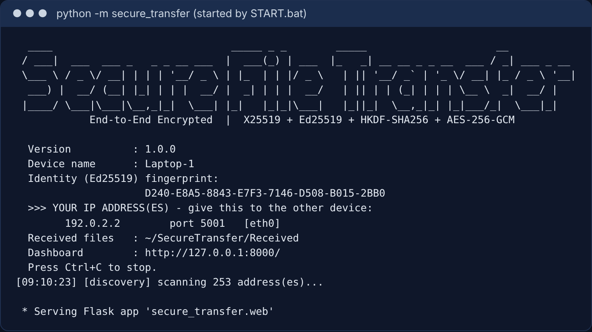

### 2) لوحة التحكم — الجهاز الآخر اكتُشف تلقائياً
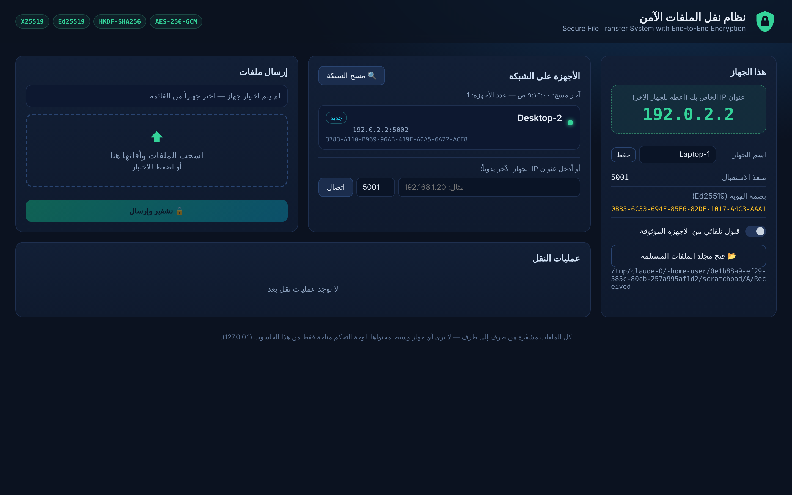

### 3) اختيار الجهاز والملفات (سحب وإفلات)
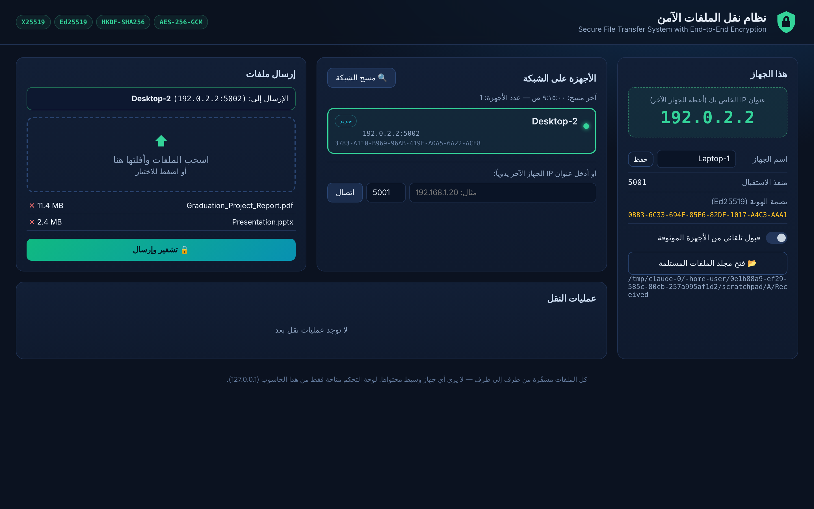

### 4) عند المستلم: طلب استلام مع رمز التحقق (SAS) والبصمة
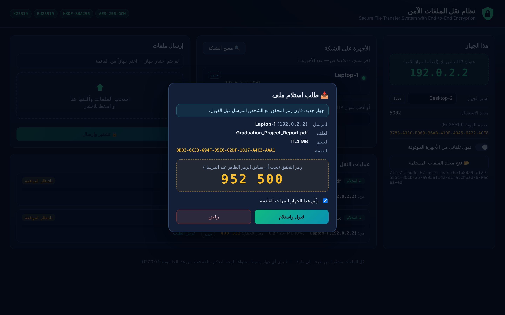

### 5) عند المرسل: بانتظار الموافقة — نفس رمز التحقق يظهر هنا
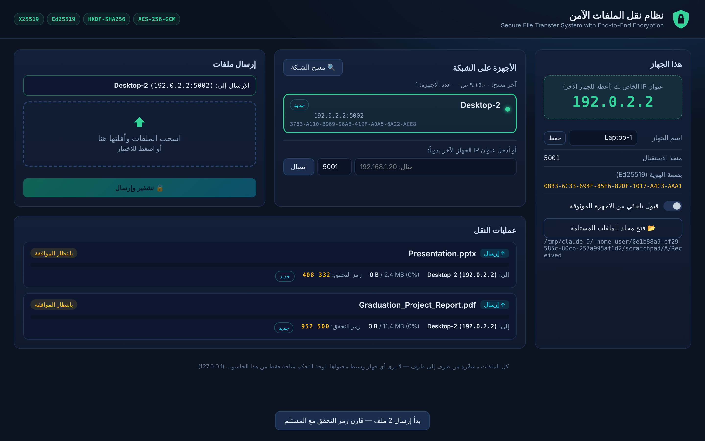

### 6) اكتمال الاستلام مع التحقق من SHA-256
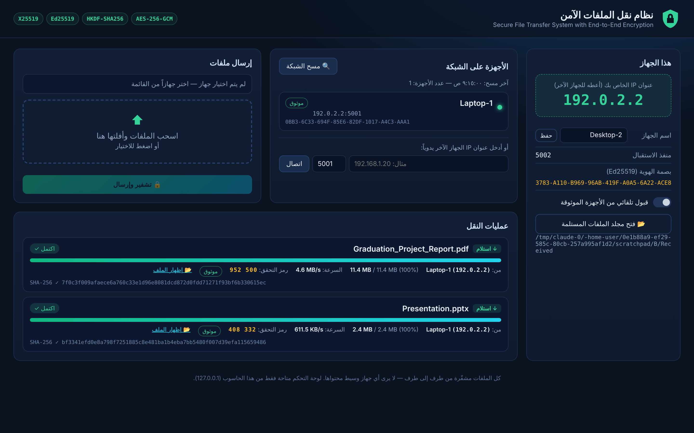

### 7) عند المرسل بعد الاكتمال
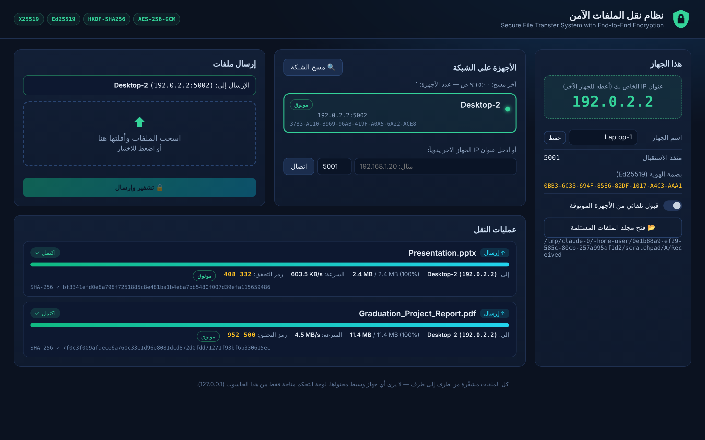

### 8) مسح الشبكة + إدخال IP يدوي
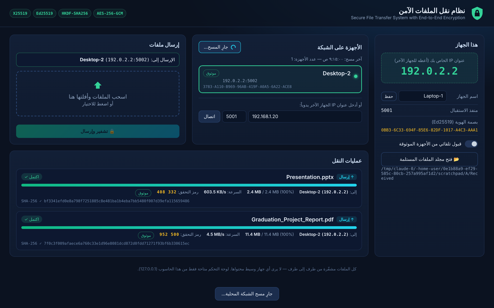

<details><summary>9) الواجهة على شاشة صغيرة</summary>

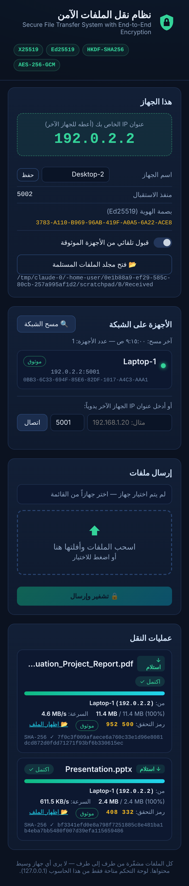
</details>

---

## 🚀 التنصيب والتشغيل على جهازي Windows

### المتطلبات
- جهازان بنظام **Windows 10 أو 11** متصلان **بنفس الشبكة** (نفس الراوتر / نفس الـ Wi-Fi أو كابل).
- **Python 3.9+** (إذا لم يكن مثبتاً، يحاول `START.bat` تثبيته تلقائياً عبر `winget`، أو حمّله من [python.org](https://www.python.org/downloads/) وفعّل خيار **Add python.exe to PATH**).
- إنترنت **في أول تشغيل فقط** لتنزيل المكتبات (`cryptography`, `flask`, `ifaddr`).

### الخطوات (تُكرَّر على كل جهاز)
1. حمّل المشروع: زر **Code ▸ Download ZIP** من GitHub ثم فك الضغط، أو:
   ```bash
   git clone https://github.com/blackangiliq/abbass_momal_graduate_project.git
   ```
2. افتح المجلد وانقر نقراً مزدوجاً على **`START.bat`**.
3. في المرة الأولى:
   - يُنشئ بيئة Python خاصة (`.venv`) ويثبت المكتبات.
   - يطلب **صلاحية المسؤول مرة واحدة** لفتح المنفذين في جدار Windows الناري
     (TCP **5001** للنقل المشفّر، UDP **50505** للاكتشاف). اضغط **Yes**.
4. تظهر نافذة سوداء فيها **عنوان IP الخاص بالجهاز** والبصمة، وتُفتح لوحة التحكم تلقائياً في المتصفح:
   `http://127.0.0.1:8000`
5. شغّل `START.bat` على الجهاز الثاني بنفس الطريقة. خلال ثوانٍ **يظهر كل جهاز في قائمة الآخر** تلقائياً.

> 💡 إن لم يظهر الجهاز الآخر: اضغط **🔍 مسح الشبكة**، أو اكتب عنوان IP الجهاز الآخر (الظاهر في نافذته السوداء) في خانة
> «أدخل عنوان IP يدوياً» واضغط **اتصال**.

### بدائل التشغيل
| الطريقة | الأمر |
|---|---|
| Windows (موصى به) | `START.bat` |
| يدوياً من الطرفية | `pip install -r requirements.txt` ثم `python -m secure_transfer` |
| Linux / macOS | `./start.sh` |
| ملف EXE واحد بدون Python | شغّل `build_exe.bat` ثم انسخ `dist\SecureTransfer.exe` و`firewall_setup.bat` للجهاز الآخر |
| إرسال من سطر الأوامر | `python -m secure_transfer send 192.168.1.20 report.pdf` |
| مسح الشبكة من سطر الأوامر | `python -m secure_transfer scan` |

خيارات إضافية: `--name "اسم الجهاز"`، `--port 5001`، `--web-port 8000`، `--data-dir PATH`، `--no-browser`.

---

## 🧭 طريقة الاستخدام
1. **المرسل**: اختر الجهاز من قائمة «الأجهزة على الشبكة».
2. اسحب الملفات إلى المربع (أو اضغط لاختيارها) ثم اضغط **🔒 تشفير وإرسال**.
3. **المستلم**: تظهر نافذة «طلب استلام ملف» فيها اسم المرسل والملف والحجم و**رمز التحقق**.
4. **قارنا رمز التحقق** (بالكلام أو بالنظر). إذا تطابق اضغط **قبول واستلام**. إذا لم يتطابق، **ارفض** لأن هناك احتمال هجوم وسيط.
5. يظهر شريط التقدم والسرعة عند الطرفين، وفي النهاية تظهر علامة ✓ مع بصمة **SHA-256**.
6. الملفات المستلمة تُحفظ في: `C:\Users\<اسمك>\SecureTransfer\Received` (زر 📂 يفتح المجلد).
7. خيار «وثّق هذا الجهاز» يحفظ مفتاحه. وإذا فُعّل «قبول تلقائي من الأجهزة الموثوقة» فلن يُسأل المستلم مرة أخرى عن هذا الجهاز.

---

## 🏗 المخطط المعماري (Architecture)
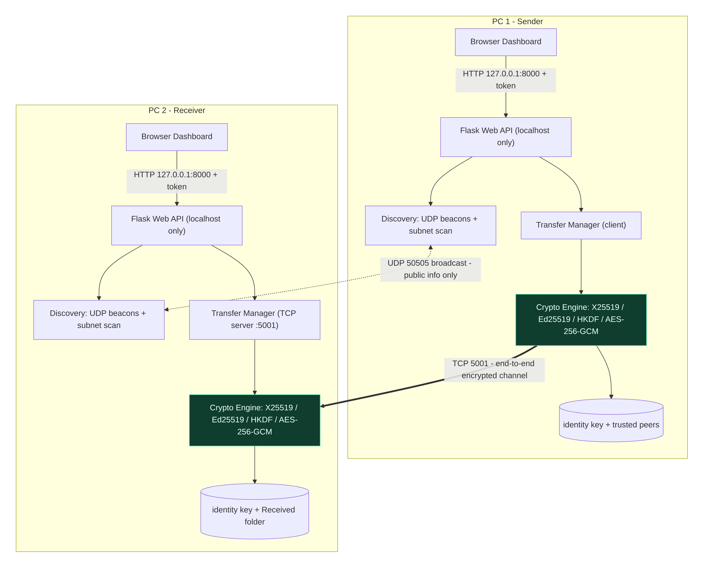

| المكوّن | الملف | الوظيفة |
|---|---|---|
| Crypto Engine | `secure_transfer/crypto.py` | المصافحة، اشتقاق المفاتيح، القناة المشفّرة AES-GCM |
| Transfer Manager | `secure_transfer/transfer.py` | خادم TCP للاستلام، عميل الإرسال، تقطيع الملفات، التحقق |
| Discovery | `secure_transfer/discovery.py` | بث UDP، مسح الشبكة، فحص IP يدوي |
| Config / Trust | `secure_transfer/config.py` | مفتاح الهوية، الإعدادات، قائمة الأجهزة الموثوقة (TOFU) |
| Web Dashboard | `secure_transfer/web.py` + `templates/` + `static/` | واجهة المستخدم و REST API محلي |
| Net utils | `secure_transfer/netutil.py` | عناوين IP، الشبكات الفرعية، عناوين البث |

### المنافذ المستخدمة
| المنفذ | البروتوكول | الاستخدام | مَن يصل إليه |
|---|---|---|---|
| 5001 | TCP | قناة النقل المشفّرة + رد على فحص الاكتشاف | الأجهزة على الشبكة |
| 50505 | UDP | بث الاكتشاف (معلومات عامة فقط) | الأجهزة على الشبكة |
| 8000 | TCP/HTTP | لوحة التحكم | **هذا الحاسوب فقط** (127.0.0.1) |

---

## 🔐 طريقة التشفير المتبعة
> الشرح الكامل بالتفصيل مع المعادلات وسبب اختيار كل خوارزمية: **[docs/ENCRYPTION.md](docs/ENCRYPTION.md)**

| المرحلة | الخوارزمية | المعيار | الغرض |
|---|---|---|---|
| هوية الجهاز الدائمة | **Ed25519** | RFC 8032 | توقيع رسائل المصافحة وإثبات الهوية |
| تبادل المفاتيح | **X25519** (ECDH مؤقت) | RFC 7748 | إنشاء سر مشترك بدون إرساله + سرية أمامية |
| اشتقاق المفاتيح | **HKDF-SHA256** | RFC 5869 | استخراج مفتاحين AES-256 (لكل اتجاه) + بادئات Nonce + رمز SAS |
| تشفير البيانات | **AES-256-GCM** | NIST SP 800-38D | سرية + سلامة + أصالة (AEAD) لكل قطعة 64KB |
| سلامة الملف | **SHA-256** | FIPS 180-4 | التحقق من أن الملف المستلم مطابق تماماً للأصل |
| التحقق البشري | **SAS** (6 أرقام) + بصمة | — | كشف هجوم الوسيط عند أول اتصال |

### مخطط المصافحة (Handshake)
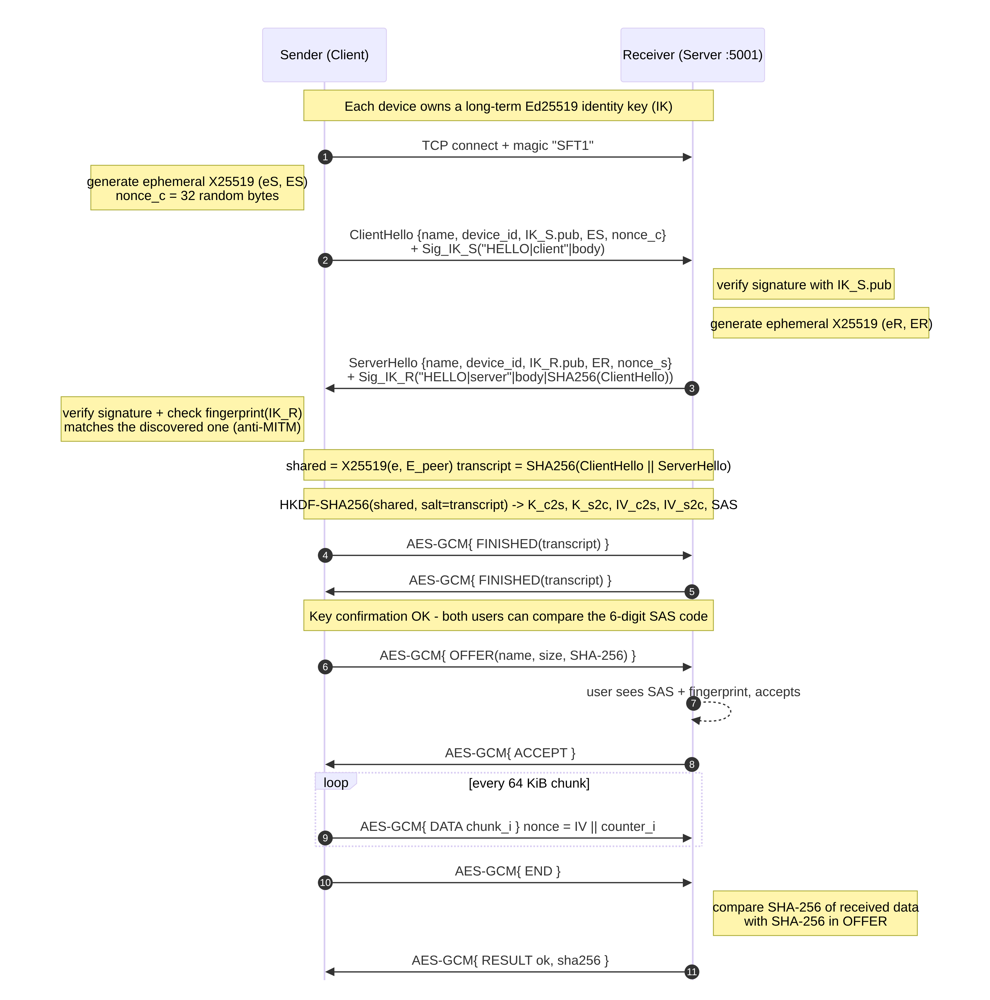

### اشتقاق المفاتيح
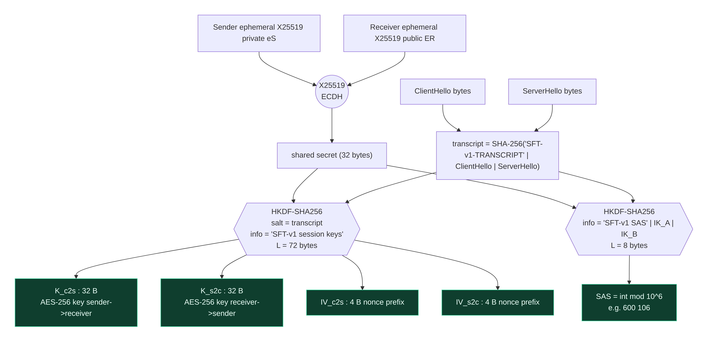

### تشفير كل قطعة (Frame)
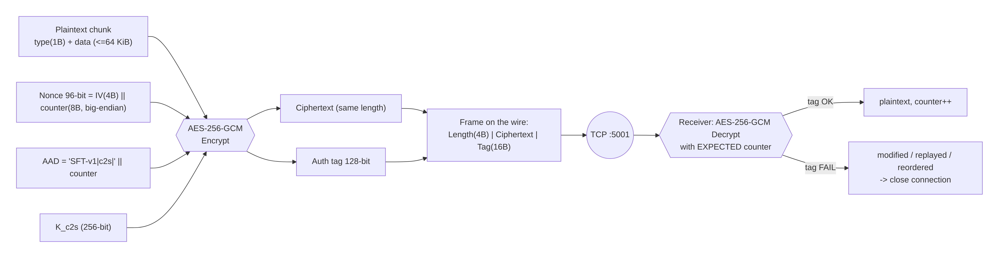

**بالمختصر:**
```
shared     = X25519(my_ephemeral_private, peer_ephemeral_public)
transcript = SHA-256("SFT-v1-TRANSCRIPT|" || ClientHello || "|" || ServerHello)
okm        = HKDF-SHA256(IKM=shared, salt=transcript, info="SFT-v1 session keys", L=72)
K_c2s = okm[0:32]   K_s2c = okm[32:64]   IV_c2s = okm[64:68]   IV_s2c = okm[68:72]
nonce_i    = IV (4 bytes) || i (8-byte counter)              ← لا يتكرر أبداً
frame_i    = len || AES-256-GCM_Encrypt(K, nonce_i, type||chunk, AAD="SFT-v1|c2s|"||i)
SAS        = HKDF(shared, salt=transcript, info="SFT-v1 SAS"||IK_min||IK_max, L=8) mod 10^6
```

---

## 🔁 المخططات الانسيابية (Flowcharts)

### تشغيل النظام (START.bat)
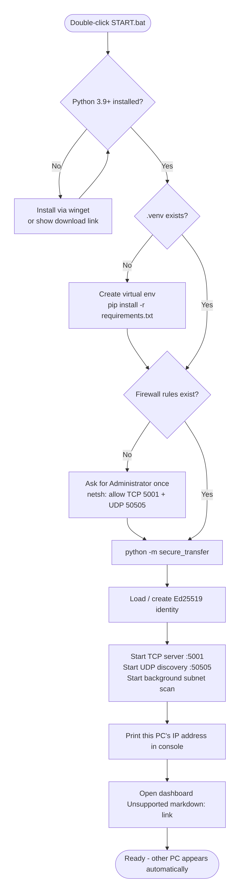

### المرسل
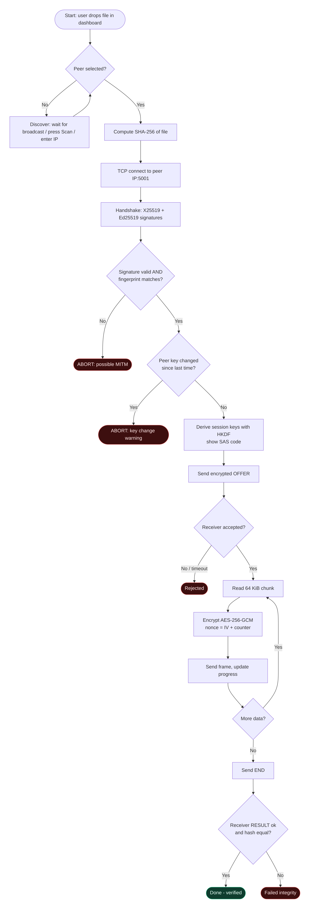

### المستلم
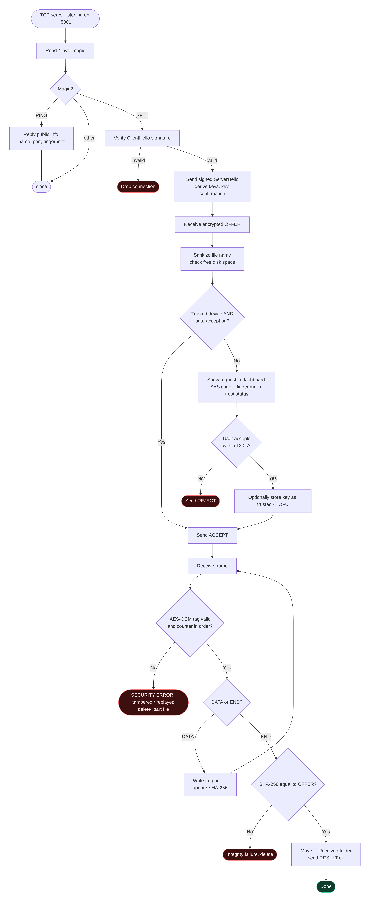

### اكتشاف الأجهزة في الشبكة
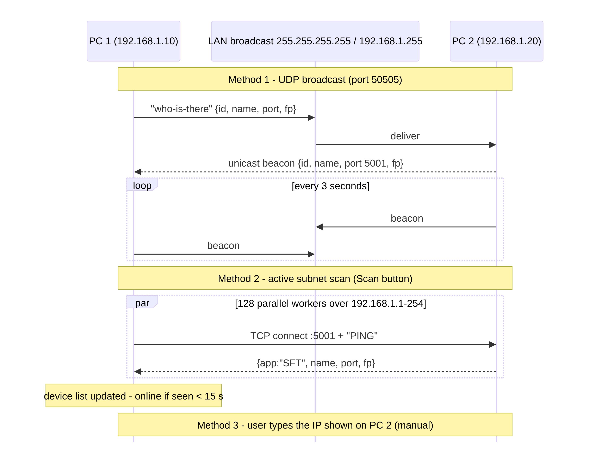

> ملفات المخططات المصدرية (Mermaid) في [`docs/diagrams/`](docs/diagrams). GitHub يعرضها مباشرة، ويمكن تعديلها وإعادة توليد الصور بـ `tools/render_diagrams.js`.

---

## 🧪 إثبات الأمان عملياً
الأداة `tools/mitm_proxy_demo.py` تضع «مهاجماً» بين المرسل والمستلم:

- **وضع التنصت (`--mode sniff`)**: الملف المرسل يحوي النص `TOP SECRET: exam answers, password=Hunter2`.
  المهاجم لا يرى إلا بيانات عشوائية، والنص **لا يظهر أبداً** في البيانات الملتقطة.
  (فقط رسالتا المصافحة الأوليتان مكشوفتان، وهما تحويان مفاتيح عامة واسم الجهاز.)
- **وضع التلاعب (`--mode tamper`)**: المهاجم يقلب **بتاً واحداً** فقط. المستلم يكتشف ذلك فوراً
  (`authentication failed: data was modified, replayed or forged`)، ويقطع الاتصال، ويحذف الملف الجزئي.

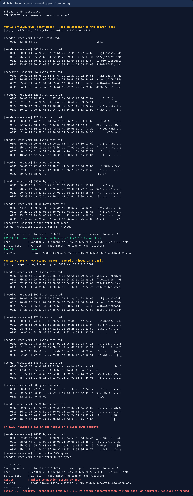

المخرجات الكاملة: [docs/security_demo_output.txt](docs/security_demo_output.txt)

```bash
python tools/mitm_proxy_demo.py --listen 6001 --target 192.168.1.20:5001 --mode sniff
python -m secure_transfer send 127.0.0.1 secret.txt --port 6001
```

---

## 📁 هيكل المشروع
```
abbass_momal_graduate_project/
├── START.bat                 ← تشغيل بنقرة واحدة على Windows
├── firewall_setup.bat        ← فتح المنافذ في الجدار الناري (يُستدعى تلقائياً)
├── firewall_remove.bat       ← حذف قواعد الجدار الناري
├── build_exe.bat             ← بناء SecureTransfer.exe (اختياري)
├── start.sh                  ← تشغيل على Linux/macOS
├── run_app.py                ← نقطة دخول لـ PyInstaller
├── requirements.txt
├── secure_transfer/
│   ├── __main__.py           ← التشغيل + عرض الـ IP + أوامر send/scan
│   ├── crypto.py             ← ⭐ قلب التشفير: المصافحة + AES-GCM
│   ├── transfer.py           ← الإرسال والاستلام والتحقق
│   ├── discovery.py          ← اكتشاف الأجهزة ومسح الشبكة
│   ├── config.py             ← المفاتيح والإعدادات والثقة TOFU
│   ├── netutil.py            ← عناوين الشبكة
│   ├── web.py                ← لوحة التحكم (Flask)
│   ├── templates/index.html
│   └── static/ (app.js, style.css)
├── tests/                    ← اختبارات pytest
├── tools/                    ← أداة الهجوم التجريبية + توليد الصور
└── docs/                     ← التوثيق + المخططات + الصور
    └── presentation/         ← 🎓 عرض المشرف (PDF + PPTX)
```

البيانات على كل جهاز تُحفظ في `%USERPROFILE%\SecureTransfer\`:
`identity_ed25519.pem` (المفتاح الخاص — لا تشاركه)، `known_peers.json` (الأجهزة الموثوقة)، `settings.json`، `Received\`.

---

## ✅ الاختبارات
```bash
pip install -r requirements-dev.txt
python -m pytest -v
```
| الاختبار | ما يثبته |
|---|---|
| `test_handshake_and_roundtrip` | الطرفان يشتقان نفس المفاتيح ونفس رمز SAS، والبيانات تمر صحيحة |
| `test_wrong_expected_fingerprint_aborts` | انتحال الهوية يُكتشف (بصمة مختلفة ⇒ قطع الاتصال) |
| `test_tampered_ciphertext_is_detected` | تغيير بت واحد ⇒ فشل التحقق |
| `test_replayed_frame_is_rejected` | إعادة إرسال إطار قديم ⇒ رفض |
| `test_sessions_use_fresh_keys` | كل جلسة لها مفاتيح جديدة (PFS) |
| `test_end_to_end_transfer` | نقل ملف 3MB كامل والتحقق منه + حفظ الثقة |
| `test_reject` | الرفض لا يحفظ أي ملف |
| `test_safe_filename` | منع `../../Windows/System32` وأسماء Windows المحجوزة |

---

## 🛠 حل المشاكل الشائعة
| المشكلة | الحل |
|---|---|
| الجهاز الآخر لا يظهر | تأكد أن الجهازين على نفس الشبكة، واضغط «مسح الشبكة»، أو أدخل الـ IP يدوياً |
| «لا يوجد جهاز يعمل عليه النظام» | البرنامج غير مشغّل على الجهاز الآخر، أو الجدار الناري مغلق: شغّل `firewall_setup.bat` كمسؤول |
| الشبكة مضبوطة كـ Public في Windows | القواعد مضافة لكل الملفات الشخصية (`profile=any`). وإن استمرت المشكلة اجعل الشبكة Private من الإعدادات |
| شبكة Wi-Fi عامة (جامعة/مقهى) | بعض نقاط الوصول تمنع الأجهزة من رؤية بعضها (AP/Client Isolation). استخدم Hotspot من هاتف أو راوتر منزلي |
| `python` غير معروف | ثبّت Python من python.org مع خيار **Add to PATH** ثم أعد تشغيل `START.bat` |
| المنفذ 5001 أو 8000 مستخدم | `START.bat --port 5003 --web-port 8003` |
| برنامج مكافحة الفيروسات يحذّر من الـ EXE | طبيعي مع ملفات PyInstaller. استخدم `START.bat` بدلاً منه |
| تحذير «⚠ تغيّر المفتاح!» | الجهاز الآخر أعاد التنصيب، أو هناك هجوم. تأكد من صاحب الجهاز قبل القبول |

---

## 📚 المصادر والمراجع
القائمة الكاملة مع الروابط: **[docs/REFERENCES.md](docs/REFERENCES.md)**

- RFC 7748 — Elliptic Curves for Security (X25519)
- RFC 8032 — Edwards-Curve Digital Signature Algorithm (Ed25519)
- RFC 5869 — HMAC-based Extract-and-Expand Key Derivation Function (HKDF)
- NIST SP 800-38D — Galois/Counter Mode (GCM)
- FIPS 197 (AES)، FIPS 180-4 (SHA-256)
- RFC 8446 — TLS 1.3 (أسلوب المصافحة وربط الـ transcript)
- Signal Protocol / Noise Protocol Framework (الأفكار التصميمية: مفاتيح مؤقتة، أرقام الأمان)
- توثيق مكتبة Python `cryptography` وإطار `Flask`

---

<div align="center">

**مشروع تخرج — Secure File Transfer System with End-to-End Encryption**

</div>
