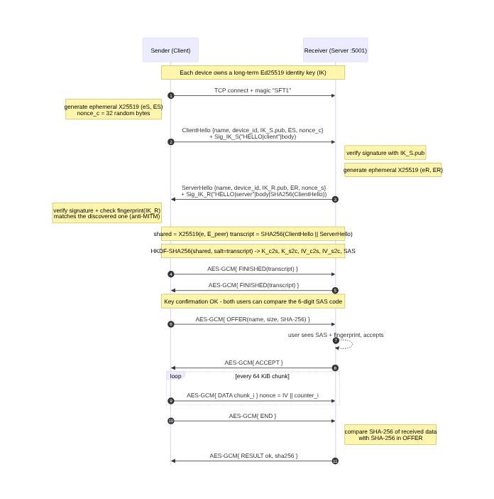
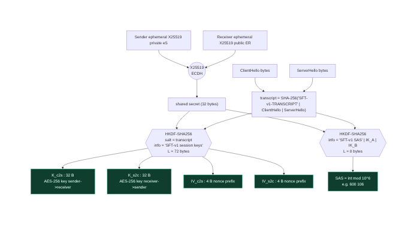
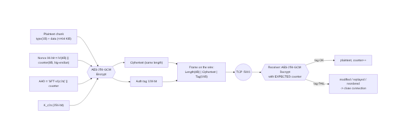

# 🔐 شرح التشفير بالتفصيل — Encryption Design

هذا المستند يشرح **كل خطوة تشفير** في النظام، و**سبب اختيار** كل خوارزمية، و**كيف يمنع** التصميم كل نوع من الهجمات.
الكود المقابل موجود في [`secure_transfer/crypto.py`](../secure_transfer/crypto.py).

---

## 1. الأهداف الأمنية
| الهدف | المعنى | كيف تحقق |
|---|---|---|
| **السرية** Confidentiality | لا يقرأ الملف إلا المستلم | AES-256-GCM بمفتاح لا يعرفه إلا الطرفان |
| **السلامة** Integrity | أي تعديل يُكتشف | وسم المصادقة GCM (128-bit) + SHA-256 للملف كاملاً |
| **الأصالة** Authentication | التأكد من هوية الطرف الآخر | توقيع Ed25519 + بصمة + رمز SAS + TOFU |
| **منع الإعادة** Anti-replay | لا يمكن إعادة إرسال رسالة قديمة | عدّاد ضمني داخل الـ Nonce |
| **السرية الأمامية** Forward Secrecy | سرقة الجهاز لاحقاً لا تكشف ملفات نُقلت سابقاً | مفاتيح X25519 مؤقتة تُحذف بعد كل اتصال |
| **E2EE** | لا يوجد خادم وسيط يملك المفاتيح | الاتصال مباشر بين الجهازين، والمفاتيح تُشتق على الجهازين فقط |

---

## 2. لماذا هذا المزيج من الخوارزميات؟
هذا المزيج هو نفسه المستخدم في الأنظمة الحديثة مثل **TLS 1.3** و**Signal** و**WireGuard** و**SSH**:

| الخوارزمية | البديل القديم | سبب الاختيار |
|---|---|---|
| **X25519** | RSA key transport, DH 2048 | مفتاح 32 بايت فقط، سريع جداً، آمن ضد هجمات التوقيت، ويعطي سرية أمامية. أمانه يعادل تقريباً 128-bit |
| **Ed25519** | RSA-2048 / ECDSA | توقيع حتمي (لا يحتاج رقماً عشوائياً عند التوقيع، فلا يتكرر خطأ PlayStation 3 مع ECDSA)، سريع، ومفتاح 32 بايت |
| **HKDF-SHA256** | استخدام السر المشترك مباشرة | السر الناتج من ECDH ليس موزعاً بانتظام. HKDF يستخرج منه مفاتيح مستقلة لكل غرض |
| **AES-256-GCM** | AES-CBC + HMAC | تشفير موثَّق (AEAD): سرية وسلامة في عملية واحدة، مسرَّع بالعتاد (AES-NI) على كل معالجات Intel/AMD الحديثة |
| **SHA-256** | MD5 / SHA-1 | لا توجد له تصادمات معروفة (MD5 وSHA-1 مكسوران) |

> **لماذا لا نستخدم RSA لتشفير الملف؟** RSA بطيء ولا يستطيع تشفير إلا بيانات صغيرة. التصميم الصحيح هو **التشفير الهجين**:
> نستخدم المفاتيح غير المتماثلة (X25519/Ed25519) لإنشاء مفتاح سري مشترك والمصادقة، ثم نستخدم التشفير المتماثل (AES) للبيانات الكبيرة.

---

## 3. المفاتيح في النظام
| المفتاح | النوع | العمر | أين يُخزَّن |
|---|---|---|---|
| `IK` مفتاح الهوية | Ed25519 (خاص 32B / عام 32B) | دائم لكل جهاز | `%USERPROFILE%\SecureTransfer\identity_ed25519.pem` |
| `e` مفتاح مؤقت | X25519 | **اتصال واحد فقط** | في الذاكرة فقط، ثم يُحذف |
| `shared` السر المشترك | 32 بايت | اتصال واحد | في الذاكرة فقط |
| `K_c2s`, `K_s2c` | AES-256 (32B لكل اتجاه) | اتصال واحد | في الذاكرة فقط |
| `IV_c2s`, `IV_s2c` | 4 بايت (بادئة Nonce) | اتصال واحد | في الذاكرة فقط |

**البصمة (Fingerprint):**
```
fingerprint = upper(hex(SHA-256("SFT-v1-FPR|" || IK_pub)))[0:32]  ← 128 bit
مثال: D240-E8A5-8843-E7F3-7146-D508-B015-2BB0
```

---

## 4. المصافحة خطوة بخطوة (Handshake)


### الخطوة 1 — ClientHello (المرسل ← المستلم)
المرسل يولّد زوج مفاتيح مؤقت `(eS, ES)` ورقماً عشوائياً `nonce_c` (32 بايت) ويرسل:
```json
{"body": {"v":1, "role":"client", "device_id":"…", "name":"Laptop-1",
          "id_pub":"<IK_S.pub>", "eph_pub":"<ES>", "nonce":"<nonce_c>"},
 "sig": Ed25519_Sign(IK_S.priv, "SFT-v1-HELLO|client|" || canonical(body) || "|")}
```

### الخطوة 2 — ServerHello (المستلم ← المرسل)
المستلم يتحقق من التوقيع، ثم يولّد `(eR, ER)` ويرسل رسالة مماثلة. لكن توقيعه يغطي أيضاً **بصمة رسالة المرسل**:
```
sig = Ed25519_Sign(IK_R.priv, "SFT-v1-HELLO|server|" || canonical(body) || "|" || SHA-256(ClientHello))
```
➜ هذا **يربط** رد المستلم بهذه الجلسة بالذات، فلا يمكن لمهاجم أن يعيد استخدام ServerHello قديماً.

### الخطوة 3 — التحقق من الهوية عند المرسل
- يتحقق من توقيع المستلم.
- يقارن `fingerprint(IK_R.pub)` بالبصمة التي ظهرت عند الاكتشاف. إن اختلفت ⇒ **إيقاف فوري** (احتمال MITM).
- يقارنها بالبصمة المحفوظة سابقاً لنفس الجهاز (TOFU). إن تغيّرت ⇒ **تحذير ورفض**.

### الخطوة 4 — حساب السر المشترك (ECDH)
```
المرسل:   shared = X25519(eS, ER)
المستلم:  shared = X25519(eR, ES)      ← نفس القيمة رياضياً، ولم تنتقل عبر الشبكة
```
**لماذا هما متساويان؟** على منحنى Curve25519: `eS·(eR·G) = eR·(eS·G)`.
المهاجم يرى `ES = eS·G` و`ER = eR·G` فقط، واستخراج `eS` منهما هو **مسألة اللوغاريتم المتقطع على المنحنيات الإهليلجية (ECDLP)**، وهي غير قابلة للحل عملياً (~2¹²⁸ عملية).

يُرفض الناتج إذا كان كله أصفاراً (نقطة ذات رتبة منخفضة low-order point).

### الخطوة 5 — اشتقاق المفاتيح (HKDF)
```
transcript = SHA-256("SFT-v1-TRANSCRIPT|" || ClientHello || "|" || ServerHello)

okm = HKDF-SHA256(IKM  = shared,
                  salt = transcript,
                  info = "SFT-v1 session keys",
                  L    = 72 bytes)

K_c2s  = okm[ 0:32]   ← مفتاح AES-256 للاتجاه مرسل → مستلم
K_s2c  = okm[32:64]   ← مفتاح AES-256 للاتجاه مستلم → مرسل
IV_c2s = okm[64:68]
IV_s2c = okm[68:72]
```
- **HKDF-Extract:** `PRK = HMAC-SHA256(salt, shared)`
- **HKDF-Expand:** `T(1) = HMAC(PRK, info||0x01)`, `T(2) = HMAC(PRK, T(1)||info||0x02)`, … حتى 72 بايت.
- استخدام `transcript` كـ salt يعني أن **أي تغيير** في رسائل المصافحة (حتى بايت واحد) ينتج مفاتيح مختلفة تماماً.
- مفتاح مستقل لكل اتجاه يمنع هجمات «الانعكاس» (إرجاع رسالة المرسل إليه).



### الخطوة 6 — تأكيد المفاتيح (Key Confirmation)
كل طرف يرسل `AES-GCM{ {"type":"finished","transcript":hex} }`. نجاح فك التشفير يثبت أن الطرف الآخر اشتق **نفس المفاتيح من نفس المصافحة**.

### الخطوة 7 — رمز التحقق البشري SAS
```
sas_raw = HKDF-SHA256(shared, salt=transcript, info="SFT-v1 SAS|" || min(IK_A,IK_B) || max(IK_A,IK_B), L=8)
SAS     = int(sas_raw) mod 1,000,000   →  "600 106"
```
إذا وُجد مهاجم في المنتصف فسيكون له اتصالان منفصلان بسرين مختلفين، فيظهر **رمزان مختلفان** على الشاشتين.
احتمال تطابقهما صدفةً = 1 من مليون.

---

## 5. تشفير البيانات (Record Layer)


لكل رسالة رقم `i` (يبدأ من 0 ويزيد بـ 1):
```
nonce_i     = IV (4 bytes) || i (8 bytes big-endian)        → 96 bit كما يوصي NIST
AAD_i       = "SFT-v1|" || direction || "|" || i
plaintext_i = type (1 byte: 0x01=JSON, 0x02=DATA) || payload
ct_i        = AES-256-GCM-Encrypt(K_dir, nonce_i, plaintext_i, AAD_i)   ← يتضمن tag 16 بايت
frame       = uint32_be(len(ct_i)) || ct_i
```

- **عدم تكرار الـ Nonce:** العدّاد يزداد دائماً ولكل اتجاه مفتاح مختلف، فلا يتكرر زوج (مفتاح، nonce) أبداً. تكراره هو أخطر خطأ ممكن مع GCM.
- **العدّاد ضمني:** لا يُرسل عبر الشبكة. المستلم يستخدم العدّاد **الذي يتوقعه**، لذلك:
  - **إعادة إرسال** إطار قديم ⇒ عدّاد مختلف ⇒ فشل الوسم.
  - **حذف** إطار أو **تغيير الترتيب** ⇒ فشل الوسم.
  - **تعديل بت واحد** ⇒ فشل الوسم (احتمال التزوير ≤ 2⁻¹²⁸ تقريباً).
- عند أي فشل: يُرمى `SecurityError`، ويُغلق الاتصال، ويُحذف ملف `.part`.
- حد أقصى 2³² رسالة لكل جلسة، و4MB لكل إطار (حماية من استنزاف الذاكرة).

### حساب الحمل الإضافي (Overhead)
كل قطعة 64KB يضاف إليها 4 بايت طول + 1 بايت نوع + 16 بايت tag = **21 بايت فقط (0.03%)**.

---

## 6. التحقق من سلامة الملف كاملاً
1. المرسل يحسب `SHA-256(file)` **قبل** الإرسال ويضعه في رسالة `OFFER` المشفّرة.
2. المستلم يحسب SHA-256 تدريجياً أثناء الاستلام.
3. بعد `END` يقارن البصمتين، ويقارن الحجم بالحجم المعلن.
4. يرد بـ `RESULT {ok, sha256}`. المرسل يتأكد أن البصمة نفسها، ثم يظهر ✓ عند الطرفين.

هذه طبقة دفاع إضافية فوق GCM، وتكشف أيضاً أخطاء القرص أو انقطاع الملف.

---

## 7. الثقة عند أول استخدام (TOFU)
مثل SSH: عند أول اتصال يقارن المستخدمان رمز SAS (أو البصمة)، ثم يُحفظ المفتاح العام في `known_peers.json`.
| الحالة | الشارة في الواجهة | السلوك |
|---|---|---|
| جهاز جديد | `جديد` | يُطلب من المستلم المقارنة والموافقة |
| مفتاح مطابق للمحفوظ | `موثوق` | يمكن تفعيل القبول التلقائي |
| نفس الجهاز بمفتاح مختلف | `⚠ تغيّر المفتاح!` | المرسل يرفض الإرسال، والمستلم يرى تحذيراً أحمر |

---

## 8. لوحة التحكم المحلية
- تعمل على `127.0.0.1` فقط، فلا يستطيع أي جهاز آخر فتحها.
- كل طلب API يحتاج **Token عشوائياً** (256-bit) يتغير مع كل تشغيل. هذا يمنع أي موقع ويب خبيث من إرسال طلبات للوحة (CSRF).
- التحقق من ترويسة `Host` يمنع هجمات DNS Rebinding.
- ترويسات أمان: `X-Frame-Options: DENY`، `X-Content-Type-Options: nosniff`، `Cache-Control: no-store`.

---

## 9. ما لا يحميه النظام (حدود التصميم)
- **البيانات الوصفية:** اسم الجهاز ومفاتيحه العامة تُرسل بدون تشفير في المصافحة ورسائل الاكتشاف (مثل TLS قبل ECH). **اسم الملف وحجمه** مشفّران.
- **حجم الملف التقريبي** يمكن تقديره من كمية البيانات المرسلة.
- إذا **تجاهل المستخدم** مقارنة رمز SAS عند أول اتصال، يمكن لمهاجم نشط في تلك اللحظة أن ينجح (مثل SSH تماماً).
- المفتاح الخاص مخزّن بدون كلمة مرور في مجلد المستخدم. التحسين المستقبلي: حمايته بـ Windows DPAPI.
- لا يحمي من جهاز مخترق أصلاً (برنامج تجسس على أحد الطرفين).

---

## 10. مقارنة مع الطرق الأخرى
| الطريقة | تشفير | سلامة | مصادقة | PFS | اكتشاف تلقائي |
|---|---|---|---|---|---|
| مشاركة مجلد SMB افتراضياً | ❌/جزئي | جزئي | كلمة مرور | ❌ | ✅ |
| FTP | ❌ | ❌ | كلمة مرور بنص واضح | ❌ | ❌ |
| HTTP عادي | ❌ | ❌ | ❌ | ❌ | ❌ |
| SFTP/SCP | ✅ | ✅ | ✅ | ✅ | ❌ (يحتاج خادم SSH وإعداد) |
| **هذا النظام** | ✅ AES-256-GCM | ✅ GCM + SHA-256 | ✅ Ed25519 + SAS | ✅ X25519 | ✅ |
