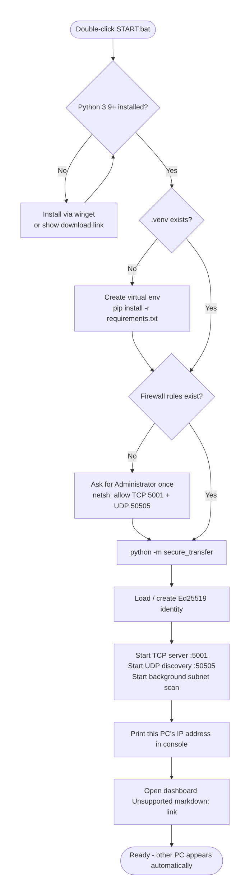

# 🪟 دليل التنصيب والتشغيل على جهازي Windows

## ما تحتاجه
- جهازان بنظام Windows 10/11 على **نفس الشبكة** (نفس الراوتر، أو Hotspot من هاتف، أو كابل مباشر).
- Python 3.9 أو أحدث (يُثبَّت تلقائياً إن أمكن).

## الطريقة 1 — START.bat (الأسهل) ✅
على **كل جهاز**:
1. انسخ مجلد المشروع إلى الجهاز (Download ZIP ثم فك الضغط، أو بفلاشة).
2. انقر نقراً مزدوجاً على `START.bat`.
3. إذا ظهرت نافذة **Windows protected your PC**، اضغط **More info ← Run anyway** (لأن الملف غير موقّع رقمياً).
4. اقبل نافذة **صلاحيات المسؤول (UAC)** مرة واحدة. هذا لإضافة قاعدتي الجدار الناري.
5. إذا ظهرت نافذة **Windows Defender Firewall** تسأل عن Python، فعّل **Private** و**Public** ثم اضغط **Allow**.
6. ستظهر نافذة سوداء فيها عنوان IP، وتُفتح لوحة التحكم في المتصفح.

ماذا يفعل `START.bat`؟ (انظر المخطط)


| الخطوة | التفاصيل |
|---|---|
| البحث عن Python | `py -3` ثم `python` ثم المسارات الافتراضية. إن لم يجده يحاول `winget install Python.Python.3.12` |
| البيئة الافتراضية | `.venv` داخل مجلد المشروع، فلا يغيّر إعدادات Python على الجهاز |
| المكتبات | `cryptography`, `flask`, `ifaddr` (في أول تشغيل فقط) |
| الجدار الناري | `netsh advfirewall firewall add rule … localport=5001 protocol=TCP` و`… localport=50505 protocol=UDP` |
| التشغيل | `python -m secure_transfer` |

## الطريقة 2 — يدوياً
```bat
cd abbass_momal_graduate_project
python -m venv .venv
.venv\Scripts\pip install -r requirements.txt
firewall_setup.bat
.venv\Scripts\python -m secure_transfer
```

## الطريقة 3 — ملف EXE بدون Python على الجهاز الثاني
على جهاز فيه Python: شغّل `START.bat` مرة واحدة، ثم `build_exe.bat`. انسخ `dist\SecureTransfer.exe` و`firewall_setup.bat` إلى الجهاز الآخر، وشغّل `firewall_setup.bat` ثم `SecureTransfer.exe`.

## معرفة عنوان IP يدوياً
يظهر في النافذة السوداء وفي أعلى لوحة التحكم. أو من موجّه الأوامر:
```bat
ipconfig
```
ابحث عن `IPv4 Address` تحت محوّل Wi-Fi أو Ethernet.

## اختبار الاتصال بين الجهازين
```bat
ping 192.168.1.20
powershell Test-NetConnection 192.168.1.20 -Port 5001
```
إذا ظهر `TcpTestSucceeded : True` فالاتصال سليم.

## تشغيل نسختين على نفس الجهاز (للتجربة)
```bat
START.bat --name PC-A --port 5001 --web-port 8000 --data-dir %TEMP%\sftA
START.bat --name PC-B --port 5002 --web-port 8001 --data-dir %TEMP%\sftB
```
ثم اضغط «مسح الشبكة»، أو أدخل `127.0.0.1` مع المنفذ `5002`.

## إزالة البرنامج
1. شغّل `firewall_remove.bat`.
2. احذف مجلد المشروع والمجلد `%USERPROFILE%\SecureTransfer` (فيه المفاتيح والملفات المستلمة).
