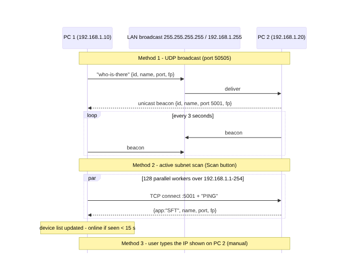

# 📡 البروتوكول وصيغة الرسائل — SFT Protocol v1

## 1. الطبقات
```
┌───────────────────────────────────────────────┐
│ التطبيق: OFFER / ACCEPT / DATA / END / RESULT │  ← JSON أو بيانات ثنائية
├───────────────────────────────────────────────┤
│ القناة الآمنة: AES-256-GCM + عداد ضمني        │  ← crypto.SecureChannel
├───────────────────────────────────────────────┤
│ المصافحة: X25519 + Ed25519 + HKDF             │  ← client_handshake / server_handshake
├───────────────────────────────────────────────┤
│ التأطير: uint32 طول (big-endian) || حمولة     │  ← send_frame / recv_frame
├───────────────────────────────────────────────┤
│ TCP :5001                                     │
└───────────────────────────────────────────────┘
```

## 2. أول 4 بايتات في اتصال TCP
| البايتات | المعنى |
|---|---|
| `SFT1` | بداية جلسة مشفّرة (مصافحة) |
| `PING` | فحص اكتشاف. يرد الخادم بإطار JSON فيه معلومات عامة ثم يغلق الاتصال |
| غير ذلك | يُغلق الاتصال فوراً |

رد `PING`:
```json
{"app":"SFT","v":1,"id":"<device_id>","name":"Desktop-2","port":5001,"fp":"B445-1A86-…"}
```

## 3. رسائل المصافحة (غير مشفّرة لكنها موقّعة)
| # | الاتجاه | المحتوى |
|---|---|---|
| 1 | C→S | `SFT1` |
| 2 | C→S | frame(ClientHello) |
| 3 | S→C | frame(ServerHello) |
| 4 | C→S | AES-GCM(FINISHED) |
| 5 | S→C | AES-GCM(FINISHED) |

التفاصيل والمعادلات في [ENCRYPTION.md](ENCRYPTION.md).

## 4. رسائل التطبيق (داخل القناة المشفّرة)
البايت الأول من النص الواضح يحدد النوع: `0x01` = JSON، و`0x02` = بيانات.

| الرسالة | الاتجاه | المثال |
|---|---|---|
| OFFER | مرسل→مستلم | `{"type":"offer","id":"a1b2…","name":"report.pdf","size":12000000,"sha256":"7f0c…","chunk":65536}` |
| ACCEPT | مستلم→مرسل | `{"type":"accept"}` |
| REJECT | مستلم→مرسل | `{"type":"reject","reason":"rejected by receiver"}` |
| DATA | مرسل→مستلم | `0x02 || <حتى 64KB من الملف>` |
| END | مرسل→مستلم | `{"type":"end"}` |
| RESULT | مستلم→مرسل | `{"type":"result","ok":true,"sha256":"7f0c…"}` |

## 5. المهلات والحدود
| البند | القيمة |
|---|---|
| مهلة الاتصال | 10 ثوانٍ |
| مهلة القراءة/الكتابة | 30 ثانية |
| مهلة موافقة المستلم | 120 ثانية |
| حجم القطعة | 64 KiB |
| أقصى حجم إطار | 4 MiB |
| أقصى عدد رسائل في الجلسة | 2³² |
| مساحة احتياطية على القرص | حجم الملف + 50MB |

## 6. الاكتشاف عبر UDP (المنفذ 50505)
- عند التشغيل يُرسل `{"type":"who-is-there", …}` إلى `255.255.255.255` وإلى عنوان البث لكل شبكة (مثل `192.168.1.255`).
- كل جهاز يسمعها يرد مباشرة برسالة `beacon`.
- كل 3 ثوانٍ يُبث `{"type":"beacon","app":"SFT","id","name","port","fp"}`.
- يُعتبر الجهاز غير متصل إذا لم تصل منه رسالة خلال 15 ثانية.
- **مسح الشبكة:** 128 خيطاً متوازياً ترسل `PING` إلى كل عناوين الشبكة /24 على المنفذ 5001 (مهلة 0.6 ثانية). مدة المسح الكامل حوالي 1 إلى 3 ثوانٍ.


