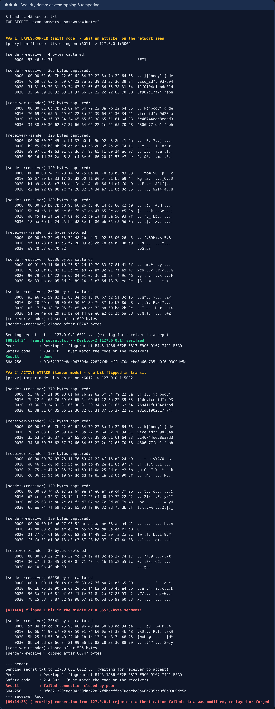

# 🛡️ تحليل الأمان ونموذج التهديد (Threat Model)

## المهاجم المفترض
مهاجم على **نفس الشبكة المحلية** (Wi-Fi مشترك، جهاز مخترق في الشبكة، ARP spoofing) يستطيع:
- قراءة كل الحزم (Passive eavesdropping)
- تعديل الحزم أو حذفها أو إعادة إرسالها أو حقن حزم جديدة (Active MITM)
- انتحال رسائل الاكتشاف (UDP spoofing)
- الاتصال بالمنفذ 5001 وإرسال بيانات عشوائية

## جدول التهديدات والحماية (STRIDE)
| التهديد | مثال الهجوم | الحماية في النظام | النتيجة |
|---|---|---|---|
| **S**poofing انتحال | جهاز يدّعي أنه «Desktop-2» | توقيع Ed25519 + مقارنة البصمة المكتشفة + TOFU + رمز SAS | ❌ يُكتشف |
| **T**ampering تلاعب | تغيير بت في الملف أثناء النقل | وسم AES-GCM لكل قطعة + SHA-256 للملف | ❌ يُكتشف ويُحذف الملف الجزئي |
| **R**eplay إعادة | إعادة إرسال قطع قديمة أو جلسة كاملة | عدّاد ضمني في الـ Nonce + مفاتيح جديدة لكل جلسة + ربط الـ transcript | ❌ يُرفض |
| **I**nformation disclosure تسريب | التنصت بـ Wireshark | AES-256-GCM. اسم الملف وحجمه داخل OFFER المشفّر | ✅ محمي (عدا اسم الجهاز) |
| **D**enial of Service | إرسال إطار بطول 4GB | حد 4MB للإطار + مهلات + خيط مستقل لكل اتصال + فحص مساحة القرص | ⚠️ مخفف |
| **E**levation / Path traversal | اسم ملف `..\..\Windows\System32\x.dll` | `safe_filename` يحذف المسارات والرموز المحظورة وأسماء Windows المحجوزة | ❌ يُمنع |
| ملفات غير مرغوبة | إرسال ملفات بدون إذن | لا استلام بدون موافقة المستخدم، والقبول التلقائي للموثوقين فقط | ❌ يُمنع |
| CSRF على لوحة التحكم | موقع خبيث يرسل POST إلى `127.0.0.1:8000` | Token عشوائي + فحص Host + الاستماع على localhost فقط | ❌ يُمنع |
| سرقة المفاتيح لاحقاً | سرقة اللابتوب بعد شهر | X25519 مؤقت (PFS): المفتاح الدائم للتوقيع فقط | ✅ الجلسات السابقة تبقى آمنة |

## تجارب عملية مُنفّذة
| التجربة | الأداة | النتيجة |
|---|---|---|
| تنصت على نقل ملف يحوي `TOP SECRET` | `tools/mitm_proxy_demo.py --mode sniff` | النص لا يظهر في البيانات الملتقطة (0 تطابق) |
| قلب بت واحد أثناء النقل | `--mode tamper` | `authentication failed: data was modified…`، والنقل فشل ولم يُحفظ ملف |
| بصمة خاطئة | `tests/test_crypto.py::test_wrong_expected_fingerprint_aborts` | قطع الاتصال |
| إعادة إطار | `test_replayed_frame_is_rejected` | رفض |

المخرجات: [security_demo_output.txt](security_demo_output.txt)

## تحسينات مستقبلية مقترحة
1. حماية المفتاح الخاص بـ **Windows DPAPI** أو بكلمة مرور (scrypt/Argon2).
2. تشفير اسم الجهاز في المصافحة (مثل Noise XX أو TLS ECH).
3. استئناف النقل بعد الانقطاع (Resume) باستخدام Merkle tree لكل القطع.
4. ضغط الملفات قبل التشفير (مع الحذر من هجمات مثل CRIME).
5. دعم المجلدات الكاملة.
6. مقاومة الحاسوب الكمّي: مصافحة هجينة X25519 + ML-KEM (Kyber) وفق FIPS 203.
